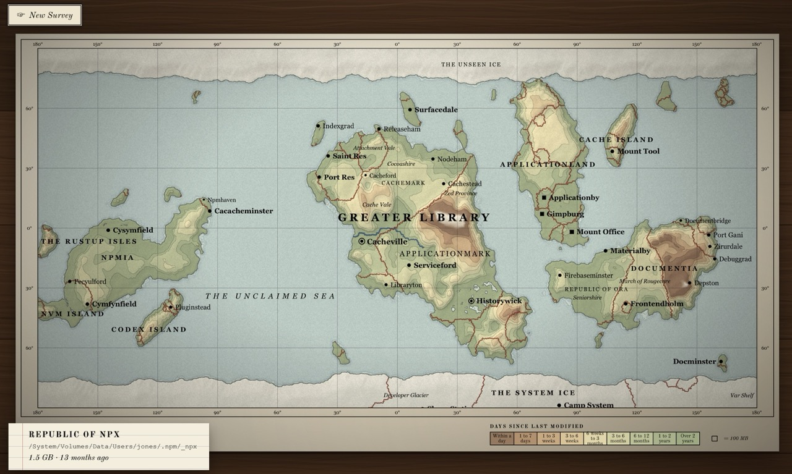

# Disk Atlas

A disk usage visualizer for macOS and Windows that draws your filesystem as an old printed world atlas.



Folders become continents, islands and nations. Area is proportional to file size, population to file count and more recent data is at higher elevation.

## Direct Download

These are built on GitHub on each release:

- **macOS** (Apple Silicon and Intel): [Disk-Atlas.dmg](https://github.com/guillaume-jones/disk-atlas/releases/latest/download/Disk-Atlas.dmg).
  - Drag the app to Applications and open it.
  - macOS will refuse at first, since the app isn't notarised: go to System Settings → Privacy & Security and click Open Anyway.
  - To scan the home folder or whole disk, Disk Atlas asks for Full Disk Access and opens the settings page. Switch it on, then reopen the app.
- **Windows**: [Disk-Atlas-setup.exe](https://github.com/guillaume-jones/disk-atlas/releases/latest/download/Disk-Atlas-setup.exe).
  - If SmartScreen warns, click More info → Run anyway.

## Development

The app uses a Rust core (`src-tauri/src`) to scan the disk and build the terrain.
Then a TypeScript/WebGL2 frontend (`src`) renders it inside a Tauri app.

### Install

You will need:
- [Node.js](https://nodejs.org) 20.19 or newer
- [Rust](https://rustup.rs) 
- [Tauri prerequisites](https://tauri.app/start/prerequisites/) (Xcode Command Line Tools on macOS, MSVC Build Tools on Windows). 

Then:

```sh
npm install
```

Cargo downloads the Rust dependencies on the first build.

### Local

Run the app on [`http://localhost:1420`](http://localhost:1420):

```sh
npm run tauri dev
```

Run just a scan without the UI:

```sh
cargo run --example atlas -- scan <folder>
```

### Build

**MacOS**:

```sh
npm run tauri build
cp -R "src-tauri/target/release/bundle/macos/Disk Atlas.app" ~/Applications/
```

Local Mac builds are signed with `bundle.macOS.signingIdentity` in `tauri.conf.json`.
Then grant disk access via Privacy & Security → Full Disk Access.

**Windows** (PowerShell):

```powershell
npm run tauri build
.\src-tauri\target\release\disk-atlas.exe
```

To install it instead, run the installer in `src-tauri\target\release\bundle\nsis\`.

### Release

Bump `version` in `src-tauri/tauri.conf.json`, then release on GitHub with a matching version tag.
Actions take care of building and signing for Apple & Windows.
